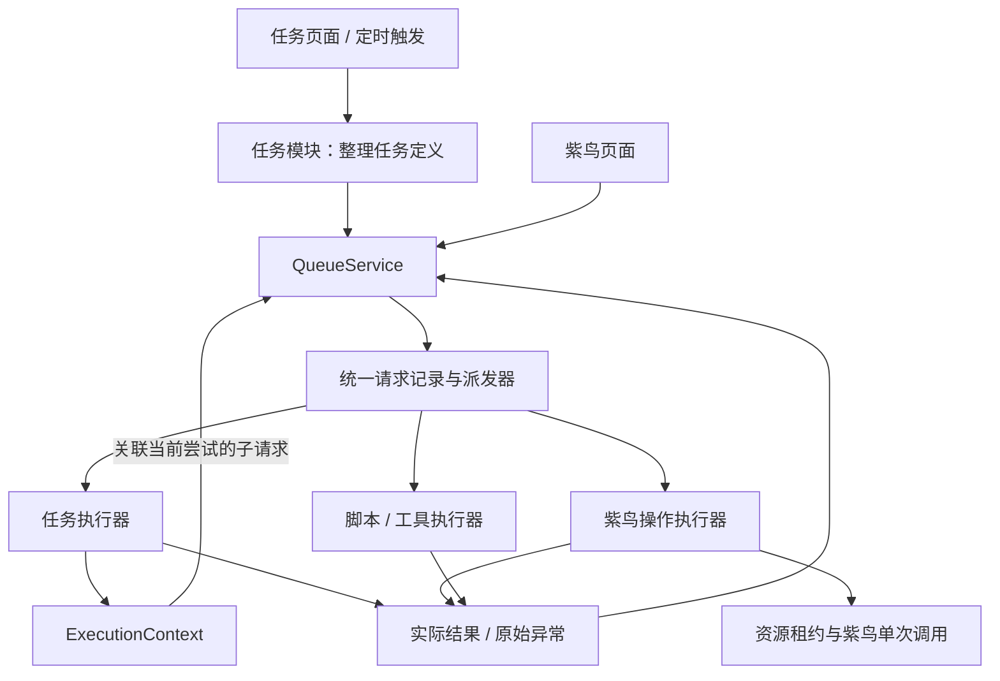

# 一期执行文档：统一排队与生命周期

日期：2026-11-09。状态：一期代码实施及再次复查修复完成，最新 98 项 Python 测试通过；上一轮 5 项日志展示测试及前端构建通过，本轮未改前端。复查发现及证据见一期验收记录，测试通过不代表所有框架缺口已消除。本文已重写并替换原四阶段方案。

## 1. 实施前提与唯一目标

当前系统尚未实际投用，可以直接调整目录、接口和表结构。不符合目标架构的代码直接删除或重写，不为旧实现保留代理层、双写、旧调度器或兼容分支。本期不承担历史数据迁移和旧版本兼容。

一期只完成一件事：**任务与紫鸟操作统一通过 queueing 模块管理接单、排队、派发、生命周期和重试。**

必须交付代码上的统一。任务页面和紫鸟页面保留各自入口，但不能各自拥有一套执行控制。一期完成后再决定其他工作，本文件不安排后续阶段。

本文是本期实施任务单。已按此重写运行代码；默认开发库改为 database/sqlite/unified.sqlite3，旧库保留，不迁移、不双写。

## 2. 直接删除或替换的旧职责

| 当前实现 | 一期处理 |
| --- | --- |
| TaskManager 的 submit、dispatch、_launch、_finish、重试判定与恢复派发 | 将必要能力重写进 queueing；删除旧控制实现，不留第二条可调用路径 |
| ResourcePool 的独立 WAITING 派发循环、pump 和开窗任务调度集合 | 删除独立调度职责；资源申请成为统一队列请求 |
| API / scheduler 直接更新执行状态、直接启动任务 | 改为调用统一控制入口 |
| ExecutionContext 直接访问 manager/store、直接启动外部操作 | 改为调用明确的上下文接口，由 queueing 登记和控制操作 |
| 模块中的独立自动重试决定 | 删除；只保留 queueing/retry.py 一个判定和预算入口 |
| task_run_request 与资源等待队列各自持有调度状态 | 用统一 work_request/work_attempt 代替调度职责；租约表只表达资源归属与占用 |
| 旧接口、测试对旧派发器的依赖 | 一次性更新调用方和测试；验证业务行为，不维护旧实现形状 |

可以保留且继续验证的底层能力：Windows Job Object、脚本流式日志、数据库事务、紫鸟单次调用适配、日志查询、任务定义与页面组件。保留以职责正确为条件，不要求为重写而重写。

## 3. 一期代码结构

```text
agent_platform/
  queueing/
    service.py       # 接单、取消、暂停、继续、停止服务的公共入口
    repository.py    # 请求/尝试/预算及原子提交
    lifecycle.py     # 合法状态变化和最终结果确认
    dispatcher.py    # 唯一派发循环，统一容量分配
    retry.py         # 唯一自动重试判定
    recovery.py      # 重启核对与恢复决定
    faults.py        # 完成提交故障，停止普通工作并保留清理控制
    models.py        # 请求、尝试、策略和结果类型
  tasks/             # 任务定义、输入校验、处理器注册、任务页面接口
  scheduler/         # 定时触发；只提交 task.run 请求
  executions/        # 受限上下文、进度、计时
  resources/         # 窗口归属、租约、占用事实、交接确认
  runtime/           # 单次脚本执行、停止、进程管理、流式输出
  tools/             # 单次工具调用与能力登记
  connectors/        # 紫鸟单次调用与原始返回
  settings/          # 全局策略校验及持久化
  database/          # 数据库连接、建表和事务
  logs/              # 原始证据、事件登记、查询
  api/               # 提交控制命令、读取结果
```

代码约束：队列/尝试生命周期只能由 queueing 写入；资源归属由 resources 提供受约束的事务操作，统一控制器确认交接；其他模块报告事实，不自行派发、终结或重试任务。运行器内部的管道读取、进程监测协程不算第二套业务调度。

## 4. 一条执行路径



一期接入类型：task.run、ziniao.acquire、ziniao.release、ziniao.inspect、紫鸟连接验证/账户查询、script.run、tool.call。

纯本地状态及日志查询不进入执行队列。查日志不能等一个任务执行名额。

执行器提供单次 execute，以及需要时的 cancel、reconcile；返回实际证据。不得在执行器内部因失败自行重新执行。

任务页面继续提供“运行、暂停、继续、结束”；紫鸟页面继续展示窗口与相关操作。入口独立，控制代码统一。不要求把所有按钮移到总队列页面。

## 5. 最小数据模型与生命周期

统一使用：

- **work_request**：一次工作请求。保存类型、输入、根请求/父尝试关联、提交键、状态、等待原因、可执行时间、策略快照和关联对象。
- **work_attempt**：请求的一次实际执行。保存执行器、开始/结束时间、结果、原始错误证据与实际停止确认。
- **retry_budget**：根请求的自动重试总预算及已消耗数量。
- **control_command**：暂停、取消、核验、停止等命令的提交与实际确认结果。
- **task_info / execution_info**：任务定义和业务执行记录，不另建独立派发逻辑。
- **resource_info / resource_lease**：真实资源占用和归属。取得窗口的请求结束，不表示租约已经释放。

请求基本路径：QUEUED → RUNNING → SUCCEEDED / FAILED / CANCELLED / TIMEOUT。自动重试使用 RETRY_WAIT 和明确的 ready_at；无法判定外部结果时暂停自动派发并登记 NEEDS_REVIEW 和具体证据。

业务返回后必须先处理必要收尾。只有完成条件成立才提交整体结果。原始异常独立保存，UNKNOWN 或 NEEDS_REVIEW 只表达调度/诊断含义，不包装错误。

最终本地提交应一次完成请求、尝试、任务执行投影、预算与事件的关联更新。外部调用不放进数据库事务；采用调用前登记意图、调用后登记实际结果、重启后必要核验。

重复提交采用“提交键 + 输入校验”：同键同输入返回原请求，同键不同输入报冲突。API 返回请求/命令 ID；等待响应超时后仍可查询实际结果，不能直接认定后台操作失败。

## 6. 一套重试代码、一份可追溯预算

1. 改造前的 TaskManager._finish 和资源独立派发已删除。当前自动重试只由 queueing/retry.py 决定，正常核验和清理不是整任务重跑。
2. 重写后，所有自动重试由 queueing/retry.py 决定，模块只能报告异常及操作能力。
3. 根请求提交时冻结总重试预算。父任务和子操作每次自动重新派发都消耗同一份预算，首次尝试不扣重试预算；扣减与重新排队原子提交，重启不清零。
4. 禁止任务、窗口、HTTP 各维护独立计数而使实际次数相乘。预算耗尽后父任务也不能换一层继续自动重试。
5. 是否可重试要同时看预算和安全条件：幂等、外部幂等键或已确认未发生副作用。未声明安全性的操作默认不自动重放。
6. 整任务从头重跑必须有明确的 restart_safe 声明；不能因一个子操作失败就无条件重做已完成的外部动作。
7. 取消、清理和核验是关联原执行的控制请求，有统一引擎管理的有限预算；只能重试控制动作，不能借此重跑业务。
8. 人工重新运行创建新根请求并记录旧请求关联；它与原请求后台自动重试分开显示。

配置页统一显示自动重试总预算、间隔、允许条件、已用及剩余次数。直接替换旧重试配置含义和字段，不保留旧版本策略分支；原有开发数据不作为迁移负担。

## 7. 一期必须具备的容量与资源规则

一个 dispatcher 管理所有类型，但各类请求使用对应容量：任务执行名额、紫鸟调用名额、窗口占用容量，以及保留的清理/取消容量。统一管理不等于把所有请求串行化。

首版运行中的任务等待子操作时可以保留任务名额；子操作不再申请任务名额。未提供可持久化接续点时，不声称可以释放 Python 内存栈后随意恢复。

普通请求按满足条件时的先后顺序派发；同店铺互斥，不同可用店铺可独立推进。归还、取消不能被普通队列容量堵死。所有数量和运行时间策略在配置页有明确入口、范围与生效时点。

资源交接顺序：确认使用者已停止使用 → 关闭窗口 → 核验关闭 → 释放容量。任何一步失败都记录实际原因，不能越过确认而伪报正常释放。资源待核验时禁止误交付，并提供关联的核验操作入口。

## 8. 停止与重启纳入同一个控制器

- 开始停止时拒绝新根工作，不再派发新任务；已有执行需要的子操作和清理控制仍可推进。
- 等待时长和到期后的继续等待/取消行为读取统一策略。
- 收尾期间保持状态、日志与必要控制可用，允许人工结束卡住的执行，不能把所有修改一律禁掉。
- 运行到期与收尾到期均提交统一取消请求，不在主循环等待单项停止；超时命令绑定原尝试，不能取消后来开始的尝试。
- 普通工具须等实际调用结束才允许窗口交接；没有通用强杀能力时不伪报已停止。收尾必须处理已经排队的控制请求，即使当前没有运行协程。
- 确认执行与资源收尾结果后退出；清理失败提供具体证据，不伪报已完全清理。
- 重启先取得同一数据库的稳定排他权，再核对请求、尝试及资源；不能因换 state-dir 绕过排他。
- 队列按已存顺序恢复；明确完成的工作不重放；结果不明的外部动作先核验。恢复核对完成后才开放新任务派发。

## 9. 一期实施任务单

以下都是本期内的开发步骤，不是四个交付阶段；未全部通过不能宣布一期完成。

- [x] 01 重写数据结构与类型，建立统一请求、尝试、预算、命令仓库；开发数据库可以按新结构重建。
- [x] 02 实现生命周期和原子结果提交；补结束中断、重复完成、重复取消的测试。
- [x] 03 实现唯一 RetryPolicy 与预算消耗；补父子请求混合失败的调用次数测试。
- [x] 04 实现唯一 dispatcher，落实任务、紫鸟与控制容量及依赖规则。
- [x] 05 将任务页面、定时触发、重试、续跑接入新服务，删除旧任务派发控制。
- [x] 06 将窗口申请、归还、核验、回收及紫鸟页面外部调用接入新服务，删除旧资源派发控制。
- [x] 07 更新 ExecutionContext、脚本与工具执行器，登记父尝试及实际结果；保留流式日志和受管进程能力。
- [x] 08 实现统一取消、停止服务、资源交接及恢复；补实例排他和故障核验。
- [x] 09 更新配置和页面接口，显示请求/命令状态、重试消耗及具体错误；去掉旧接口和旧状态写入。
- [x] 10 删除失效代码和测试，完成全局验收，更新 README 与实际代码职责说明。

开发时按实际受影响范围核对并重建开发数据，不运行真实店铺业务来凑验收。文件修改、删除和数据库重建应明确目标路径，避免影响项目之外的数据。

## 10. 一期验收：用行为证明统一

| 场景 | 必须成立的结果 |
| --- | --- |
| 手动、定时、重试、续跑进入系统 | 同一准入、派发、生命周期代码，没有旧旁路 |
| 任务页面与紫鸟页面分别操作 | 页面独立；后台请求进入同一个队列服务 |
| 同提交键请求两次 | 不重复执行；同键不同输入明确拒绝 |
| 根预算 2，任务/窗口/工具接连失败 | 总自动重试不超过 2，不能逐层相乘，重启不增加预算 |
| 外部已执行但返回丢失 | 保存实际证据并核验，不直接重跑整任务 |
| 执行完成提交中途写库失败 | 请求、尝试和业务执行不出现不可恢复的半完成状态 |
| 任务容量 2、窗口容量 1，A/B 运行、C 排队 | A/B 的开关窗可继续；清理/取消不需要等待 C 的任务名额 |
| 同店铺竞争、不同店铺同时申请 | 同店铺有序互斥，其他可用店铺不被无关等待堵住 |
| 停止脚本失败或关窗失败 | 不误释放容量、不伪报成功，页面能看到具体原因 |
| 单个请求输入错误或执行报错 | 其他正常请求继续派发；保留该请求原始异常 |
| 混合运行、排队、暂停、等待资源时停止 | 拒绝新工作，允许收尾和人工结束，策略可配置 |
| 服务中断后启动；换 state-dir 再次启动 | 只允许一个控制者；核对已有结果，队列不重复启动 |
| 脚本大量输出、取消或超时 | 保持分段入库、有限内存及已落库证据，不因重写退化 |

验收需要同时检查代码边界：除 queueing 之外不得保留自动重试判定和业务请求派发；API、scheduler、connector 不直接写队列/执行终态。边界检查与入口跟踪测试进入自动验证，不能只靠开发者记住文档。

## 11. 一期范围和完成定义

一期范围是单机统一执行控制。当前异步任务处理器需遵循非阻塞接口；本期不承诺能强制隔离任意 Python 阻塞代码，也不引入分布式执行或通用工作流解释器。验收不能把普通异常隔离等同于完整进程隔离。

不为旧代码保留兼容控制器，不开发历史数据迁移，不安排多阶段路线图。容量/超时、日志证据和最小恢复能力属于本期完成统一控制所必需的内容。

一期完成必须同时满足：**任务与紫鸟走同一个队列服务；只有一套派发、生命周期和重试决定；旧控制路径已删除；页面入口独立；全局验收通过。**

如果只建立新模块但旧 manager/pool 仍能各自派发，或者只写了统一规则但实际调用没改，一期就是未完成。


## 12. 实际接口与验证边界

实现增加 `queueing/connections.py` 注册账户查询、验证/保存连接和端口检测执行器。窗口操作在同一店铺维度串行，取消命令使用独立 commands 名额，避免等待窗口收尾时占满清理名额。

执行器统一声明 `interruptible`，默认为 false：取消等待真实调用结束再确认，避免底层线程还在运行时误报完成。只有任务和受管脚本在其子操作或进程已经停止后允许中断协程。该规则涵盖工具和所有紫鸟连接操作，不维护各模块自己的取消例外列表。API 记录错误日志再次失败时仍返回原始操作原因，附写入失败证据并输出服务诊断。

配置：`queue.retry` 使用 `enabled / total_retries`；`queue.capacity` 管理任务、紫鸟、脚本/工具、控制、取消及窗口容量。任务和工具通过 `restart_safe=True` 声明重放安全性，默认 false。开窗异常只有声明 no_side_effect 且独立核验窗口未打开，才具备重试资格；预算消耗仍由统一引擎决定。

API：`POST /api/action` 提交任务、外部操作或控制命令；外部操作立即返回 `operation_id`，`GET /api/operations/{id}` 读取实际结果。删除旧 /run 等动作别名。日志查询保留现有数据库分页接口。

恢复不接续已丢失的 Python 栈，删除旧 resume_waiting 接口。未收到结果的运行尝试需核验，其未启动子请求取消；未派发根请求和已安排重试保留。资源只能在确认关闭后解除占用；只读核验不会关闭外部窗口。

完成提交故障由 `queueing/faults.py` 统一处理：停止普通工作接单和派发，保留清理/取消通道，原业务异常和提交异常同时记录。能提交时登记需核验，持续不可写时保留原 RUNNING 意图并输出诊断，不伪报成功；恢复读取此前已保存的提交故障证据。`logs/errors.py` 对保存证据的内部传递原样还原，不增加 PersistedFailure 诊断包装。控制权限由执行器类型确定，子操作必须关联同一执行的有效父尝试。

测试使用 Windows + SQLite 和模拟紫鸟，真实脚本进程、HTTP 面板及启动器使用隔离实例。未执行真实店铺操作，PostgreSQL 尚未实连验证。详细验收与范围见 [一期验收记录](phase-one-acceptance.md)。
